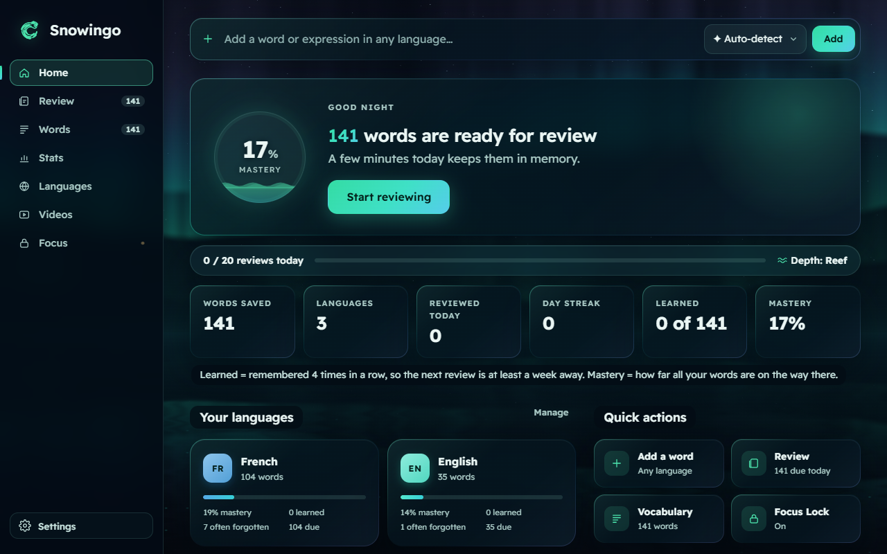
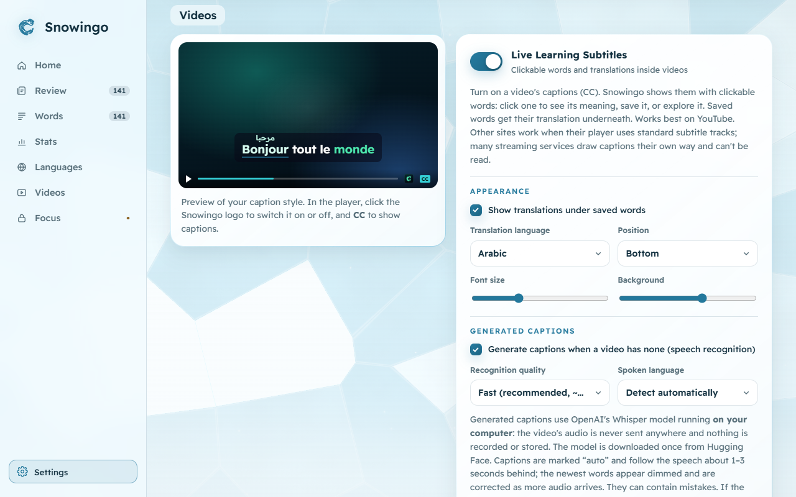
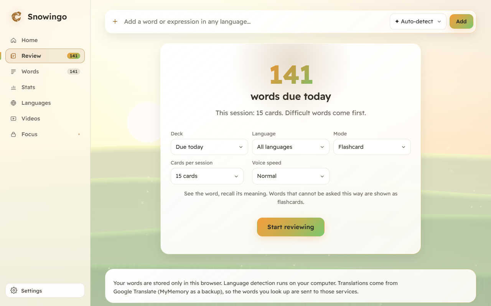

# Snowingo – Multilingual Word Notebook

A free browser extension for people learning several languages at once.
Save words from any web page or video. Snowingo detects the language for you,
and spaced repetition helps you remember them.

Works in **Chrome, Brave, Edge, Opera and Vivaldi**.

## Download

**[⬇ Download the latest version](https://github.com/ayoubiii2007benh-cyber/snowingo/releases/latest)**: open the page and click `snowingo-x.y.z.zip` under *Assets*.

## Install (about 1 minute)

1. **Unzip** the downloaded file: right-click it → *Extract All…*.
   Put the folder somewhere permanent, such as `Documents\Snowingo`. If you delete or move it, the extension stops working.
2. Open the extensions page. Type this in the address bar:
   - Chrome: `chrome://extensions`
   - Brave: `brave://extensions`
   - Edge: `edge://extensions`
3. Turn on **Developer mode** (top right in Chrome and Brave, left side in Edge).
4. Click **Load unpacked** and select the folder you unzipped (the one that contains `manifest.json`).
5. Optional: click the puzzle-piece icon in the toolbar and **pin** Snowingo.

Your browser may sometimes show a notice about developer-mode extensions. That is normal for extensions installed this way. You can close it.

**PDFs on your computer** (optional): on the extensions page, click **Details** on Snowingo and turn on **Allow access to file URLs**.

## Update to a new version

Your words stay safe when you update. They are stored in the browser, not in the folder.

1. Download the new zip from the [releases page](https://github.com/ayoubiii2007benh-cyber/snowingo/releases/latest).
2. Unzip it and **replace the files in your existing Snowingo folder** with the new ones. Keep the same folder.
3. Open the extensions page and click the **reload** ↻ button on Snowingo.

Don't remove the extension and add it again. That would delete your words. To be extra safe, use *Settings → Backups → Export* first.

## What it does

- **Save words anywhere**: double-click a word on any page, or right-click → *Add to Snowingo*. The language is detected automatically, and English and Arabic translations are added.
- **Review so you remember**: spaced repetition, with six ways to practise (flashcards, reverse, typing, multiple choice, listening, fill-the-gap).
- **Learn from videos**: learning subtitles on YouTube and other players, using the video's own captions when it has them. Click any word for its meaning.
- **Read PDFs**: PDFs open in the Snowingo reader, where double-click translates words too. Works with PDFs on your computer as well.
- **Focus Lock** (optional): when a revision is due, websites first show a short revision screen.
- **17 animated themes**, light and dark mode. Everything, including the pop-ups on web pages, follows your theme.
- **Built-in guide**: a short captioned video and step-by-step tour (English, French, Arabic), in the sidebar.
- **Your data stays with you**: no account, no server. Export to a file, CSV or Anki.

## Privacy

Snowingo has no account and no server, and the developer collects nothing.
Words you choose to translate are sent to Google Translate (or MyMemory as a backup).
Read the full [privacy policy](https://ayoubiii2007benh-cyber.github.io/snowingo/privacy-policy.html).

The optional AI assistant uses **your own** Google Gemini API key. It is stored only in your browser and is never synced or shared.

## Help and feedback

Found a bug or have an idea? [Open an issue](https://github.com/ayoubiii2007benh-cyber/snowingo/issues).

## Copyright

© 2026 Snowingo. All rights reserved.
Snowingo is free to download and use, but it is **not** open source. You may not copy, modify or redistribute its code, design or images. See [LICENSE.txt](LICENSE.txt).
